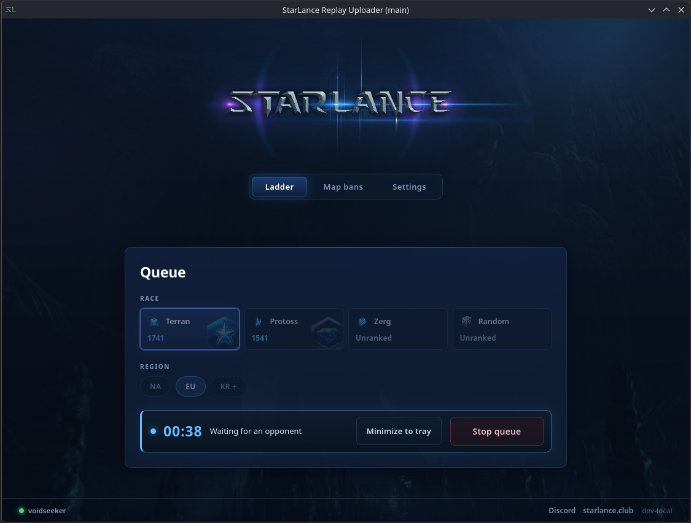

# StarLance App

StarLance is a community balance mod for StarCraft II with a ranked ladder
outside the game client. This is the desktop companion app: it watches your
StarCraft II replay folders, uploads each new game to the ladder, and shows
your queue and match state in a small window. Queue as Ranked, Unranked, or
both, with an optional preferred mode.



This repository is the full source of the app. Every release is built by
GitHub Actions from a tagged commit, not on anyone's machine, so the binary
you download corresponds to the code here.

## Download

Get the latest build from the
[releases page](https://github.com/SC2-StarLance/starlance-app/releases/latest):

| Platform | File |
| -------- | ---- |
| Windows (64-bit) | `starlance-app-windows-amd64.exe` |
| Linux (64-bit) | `starlance-app-linux-amd64.AppImage` |
| macOS, Apple silicon or Intel | `starlance-app-macos-universal.zip` |

The Windows download is a single `.exe`: double-click it and the app starts.
If Windows shows a SmartScreen warning, choose **More info**, then
**Run anyway**.

The macOS download is a universal `.app` bundle in a zip: unzip it and open
the app. The app is not notarized by Apple, so Gatekeeper warns once; open
**System Settings**, then **Privacy & Security**, and choose **Open Anyway**.

The Linux download is an AppImage: one file, no extraction. Make it
executable if your file manager does not, then run it. It uses your
distribution's GTK/WebKit, the same libraries the zip build needs.

Release files carry a project signature so the app can verify an update
before installing it.

## First launch

The app installs itself in a stable per-user folder and runs from there:

| Platform | Installed copy |
| -------- | -------------- |
| Windows | `%LOCALAPPDATA%\Programs\StarLance\starlance-app.exe`, plus a Start Menu shortcut |
| macOS | `~/Applications/StarLance App.app` (a copy already in `/Applications` stays there) |
| Linux | `~/.local/share/starlance-app/starlance-app`, plus an app-menu entry |

The downloaded file can be deleted afterwards. An existing install is never
overwritten; the app and its updater own that file. To uninstall, open
**Settings** and click **Uninstall StarLance App**. The app removes its
startup entry, its shortcut or app-menu entry, its installed copy, and the
state folder below, then quits. A copy you launched from a download folder
stays where you put it; delete that file by hand after the app quits.

If you prefer to remove files by hand, your login, settings, and upload
history live in a separate per-user state folder:

| Platform | State folder |
| -------- | ------------ |
| Windows | `%APPDATA%\StarLance\uploader\` |
| macOS | `~/Library/Application Support/StarLance/uploader/` |
| Linux | `~/.config/starlance-app/` |

## Log in

Open the window, go to the **Play** tab, and click **Log in**. Your browser
opens the StarLance authorize page; approving there issues an upload token,
which the app stores with user-only permissions. Nothing is pasted by hand
and the token is never written to settings files or the log.

The app then watches every StarCraft II account folder it can find on the
machine, one per Battle.net account, and uploads a replay as each game
finishes. Before anything leaves your machine it checks the replay: only
StarLance games are uploaded. Regular ladder, AI, and other custom games carry
no StarLance mod, so they are skipped and nothing is sent.

Only games played while the app is running and logged in count: replays
already sitting in the folder at startup are never backfilled. A StarLance
game missed while the app was off can be uploaded from its match page on
starlance.club.

## The window

- **Play**: your ladder state, Ranked/Unranked queue modes with an optional
  preferred mode star, the queue button, and the login panel when signed out.
- **Map bans**: pick the maps you do not want to play.
- **Settings**: the `/join StarLance` in-game channel, replay visibility,
  watched replay folders (add a folder, open the folder), **Start with
  system**, the version and update check, where the app is installed, and
  Quit.

**Start with system** registers the app for the current user (no admin
rights) and remembers the account profile it was enabled from, so two
accounts each start their own copy. Turning it off removes the registration.

## Updates

The app updates itself: shortly after startup and every six hours it checks
GitHub for a newer release, downloads the platform zip, verifies its minisign
signature against the public key embedded in the app, swaps the binary, and
restarts with settings, login, and history intact. A quiet notification says
when that happened. If GitHub is unreachable or a download fails
verification, the app keeps working and tries again later. Builds made from
source (`make` without `VERSION=...`) never self-update. The verification
key is embedded in the copy you already run, so a mirror or an edited download
page cannot push a different build.

## Privacy

Short version: replays you upload are stored on the StarLance server. Public
replays can be downloaded by anyone who has the link. The server also stores
your player name, Battle.net tag, account ids, queue and match history, and
logs IP addresses. A replay is private when either player had public replays
off at match time; private replays are downloadable only by the two players
and StarLance admins. Match results and ratings stay public. The **Public
replays** switch in Settings applies to future matches. There is no account
deletion feature yet. The full description is in [PRIVACY.md](PRIVACY.md).

## Build from source

Requires Go 1.26.11 or newer. Blizzard artwork is not part of this repository;
it is fetched from the pinned commit in `assets.lock` (see
[NOTICE](NOTICE)) into `app/frontend/dist/`. The build fails until that fetch has
run, so the assets step is first:

```console
$ make assets          # fetch artwork from the pinned assets commit
$ make all             # linux/amd64 + windows/amd64 into bin/
$ make test            # unit tests
$ make build-macos     # macOS binary, needs CGO + Xcode tools, run on a mac
$ make app-macos       # macOS .app bundle, run on a mac
$ VERSION=1.0.0 make all   # stamp a release version
```

The Windows binary builds with `CGO_ENABLED=0` and `-H windowsgui`, so no
console window appears. Linux and macOS link the native window libraries and
need `CGO_ENABLED=1`: Linux wants the GTK 3 and WebKit2GTK 4.1 development
packages, macOS wants the Xcode command line tools.

To sign release assets the way the release workflow does, put the minisign
secret key in `MINISIGN_SECRET_KEY` and run:

```console
$ make sign FILES="dist/*"
```

Each file gets a `.minisig` next to it.

## Contributing

Bug reports and ladder suggestions are welcome in the
[issue tracker](https://github.com/SC2-StarLance/starlance-app/issues). This
project does not take pull requests; changes land through the maintainers.

## License and notices

The app's own code is licensed under the [MIT License](LICENSE). The StarLance
name and logo are not covered by that license: fork and modify the code, but
do not present a reskinned build as the StarLance App. StarCraft II artwork shown
in the app belongs to Blizzard Entertainment and is fetched from a separate
assets repository; see [NOTICE](NOTICE) for details.
